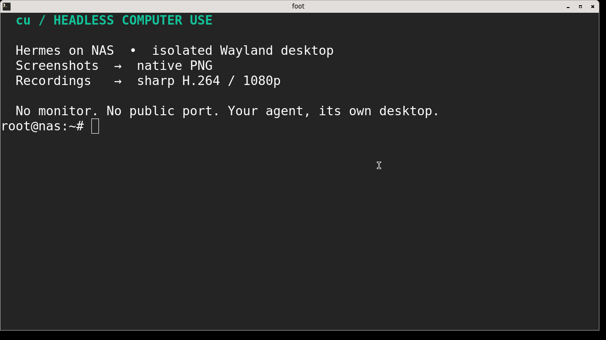

# cu · a desktop for your agent

**Headless Linux computer use. Native screenshots. Shareable recordings.**

Give Hermes (or any MCP client) its own Labwc desktop on a NAS — without a
monitor, a public remote-desktop port, or a permanent MCP daemon.

| Observe | Act | Share |
| --- | --- | --- |
| Original-size inline PNG + window titles | Type, click, scroll, drag and draw | H.264 MP4 with agent cursor + click rings |



[Watch the real NAS recording](examples/nas/desktop.mp4) ·
[Computer-use skill](skills/cu-computer-use/SKILL.md) ·
[Drawing demo](examples/horse/PROMPT.md)

## Install in one line

After installing the dependencies below, clone the **private** repository with
an authenticated SSH key, build, install, and register Hermes:

```sh
git clone --branch main git@github.com:0xveya/cu.git cu && cd cu && bash scripts/install.sh --hermes
```

Choose a different unused directory if `cu` already exists. No token is embedded
in the command. Review the installer before running it. It installs to
`~/.local/bin/cu`, checks prerequisites, and uses the official Hermes MCP CLI;
it never edits Hermes YAML by hand. Answer **Y** to enable the five tools.
Omit `--hermes` for CLI-only installation. Existing checkout:
`bash scripts/install.sh --hermes`.

### Dependencies (Debian 13 / compatible Linux NAS)

```sh
sudo apt-get update && sudo apt-get install -y labwc grim wtype ffmpeg foot fonts-dejavu-core libwayland-dev pkg-config build-essential git
```

Install **Go 1.26.5 or newer** separately, or use the repository's pinned `mise`
tools. Go may download its required toolchain and modules during the build.
Hermes must already be installed for `--hermes`. `foot` is the demo terminal;
install browsers or other GUI apps separately. Building needs CGo, a C compiler,
`wayland-client` development headers, and `pkg-config`.

The installer does not run `sudo`, install OS packages, change login policy,
or start a desktop. To deploy an already-built, trusted native binary:

```sh
bash scripts/install.sh --binary ./bin/cu --hermes
```

Add `~/.local/bin` to `PATH` if needed. `CU_INSTALL_DIR` overrides the install
directory. Binaries must match the target architecture and libc; they link
Wayland dynamically and are not portable static executables.

### SSH / headless prerequisites

Use a Linux NAS with **systemd as PID 1** and a running **user** manager.
A plain Docker shell without user systemd is not enough. Log in through PAM
(normal SSH), then check:

```sh
systemctl --user show-environment
printf '%s\n' "$XDG_RUNTIME_DIR"
```

For unattended agents an administrator may enable lingering for the Hermes
account. This deliberately keeps its user services alive after logout:

```sh
sudo loginctl enable-linger "$(id -un)"
```

For non-login services, set `XDG_RUNTIME_DIR=/run/user/UID` and
`DBUS_SESSION_BUS_ADDRESS=unix:path=/run/user/UID/bus`, replacing UID with the
actual account UID. The manager and socket must already exist; do not invent
a runtime directory under `/tmp`. Run Hermes and `cu` as the **same account**.
Prefer a dedicated unprivileged account for production. The NAS verification
used the existing Hermes account, not a new privileged service.

## Hermes: ready to use

```sh
hermes mcp add cu --command "$HOME/.local/bin/cu" --args mcp
hermes mcp test cu
hermes mcp list
```

The installer already registers MCP when `--hermes` is selected. Start a new
Hermes session, or run `/reload-mcp` in a supported open session. The five tools
are `desktop_session`, `desktop_launch`, `desktop_observe`, `desktop_act`, and
`desktop_record`. Give every agent a distinct desktop ID:

> Start a headless desktop named `research-1`, launch `foot`, type a greeting,
> observe the desktop, then record a few interactions at 12 fps and normal
> speed. Stop the recording before stopping the desktop.

Optionally copy `skills/cu-computer-use` into the active Hermes profile's
`skills/` directory for workflow guidance; do not overwrite an existing skill.
See the [official Hermes MCP documentation](https://hermes-agent.nousresearch.com/docs/user-guide/features/mcp).

## First headless desktop

```sh
cu start --id agent-1
cu launch --id agent-1 -- foot
cu windows --id agent-1
cu screenshot --id agent-1 --out "$PWD/desktop.png"
cu record start --id agent-1 --out "$PWD/desktop.mp4" --fps 12 --speed 1
# Let your agent interact; recording continues across CLI/MCP calls.
cu record stop --id agent-1
cu stop --id agent-1
```

Wait for the app to appear in `windows` before sending input. Headless sessions
need no host Wayland display. `--visible` nests inside an existing desktop.

### Recording quality

Headless videos fit into **1920×1080 without stretching**: Lanczos scaling,
centered dark padding, H.264 **CRF 18 / fast**, browser-friendly `yuv420p`, and
fast-start MP4. Visible sessions retain their dimensions, padded to even pixels.
The existing agent cursor and click-ring overlays remain. Encoding uses more
CPU than the old ultrafast preset; reduce `--fps` on a busy NAS. Screenshots and
action coordinates always use native desktop pixels, not video pixels.

Use `--fps 12 --speed 1` for smooth real-time demos. CLI defaults remain 4 fps /
4× playback for compatibility; MCP defaults are 8 fps / real time. Accelerated
videos retain their speed badge. Output files must not already exist. Stop the
recorder before its desktop to finalize the MP4 cleanly.

### Security boundary

**Desktop isolation is not a sandbox.** Apps run as the Hermes account and can
access its files and network. Use a dedicated account/container/VM with an
appropriate security policy for untrusted apps; never expose GitHub tokens or
SSH keys unnecessarily. Stdio is recommended; optional HTTP binds loopback,
not the public NAS interface. Sessions live under `$XDG_RUNTIME_DIR/cu/<id>`
and are cleaned by `cu stop`. User systemd keeps Labwc and launched apps alive
between CLI calls.

## Try it

Build with `mise run build`, then give your agent the
[horse demo prompt](examples/horse/PROMPT.md). It asks the agent to use `cu`
to draw a horse with the pen tool and colored cells in LibreOffice Calc,
inspecting the desktop after significant actions. The workbook, screenshots,
and recordings are in `examples/horse/`.

## Commands

```sh
mise run build

bin/cu start --id agent-1 --visible
bin/cu status --id agent-1
bin/cu launch --id agent-1 -- foot
bin/cu run --id agent-1 -- env
bin/cu type --id agent-1 --text 'hello'
bin/cu key --id agent-1 Return
bin/cu key --id agent-1 ctrl+l
bin/cu move --id agent-1 --x 500 --y 400
bin/cu click --id agent-1 --x 500 --y 400
bin/cu click --id agent-1 --x 500 --y 400 --button right
bin/cu drag --id agent-1 --from 500,200 --to 800,400
bin/cu scroll --id agent-1 --x 500 --y 400 --delta-y 120
bin/cu view --id agent-1
bin/cu windows --id agent-1
bin/cu screenshot --id agent-1 --out /tmp/agent-1.png
bin/cu record start --id agent-1 --out /tmp/agent-1.mp4
bin/cu record status --id agent-1
bin/cu record stop --id agent-1
bin/cu stop --id agent-1
```

`run` waits for the command and returns its exit status. `launch` returns after
the program starts. The original direct wrapper still works with `cu run
--display NAME -- COMMAND` for an existing socket in the caller's
`XDG_RUNTIME_DIR`.

Session commands return JSON. `windows` returns a compact JSON array of visible
app IDs and titles, so an agent can check which apps are open before requesting
a screenshot. Input commands return no output on success.
Recording captures only the named Labwc desktop, including its apps, and
returns the MP4 path as JSON. It keeps recording while other `cu` commands run.
Recording playback defaults to 4× real time. Use `--speed 1` for real time;
videos faster than real time show their speed in the top-right corner.
Visible sessions record at their current desktop size; headless recordings
default to 1920×1080. `record status` reports the output dimensions.
For a browser that fills the recording, focus it and use `cu key --id agent-1
F11` before recording.
If Labwc fails to start, `cu` prints the exact `journalctl` command for its
service. Screenshots and input always require a managed session ID, so they
cannot target the host display by accident.

`start --visible` opens the nested Labwc desktop as a window on your current
Wayland desktop. It returns immediately, so you can keep watching the window
while another terminal or agent uses `cu launch`, `cu type`, and the other
commands with that ID. Run `cu stop --id agent-1` to close it. Omit `--visible`
to start a headless session instead; visibility is chosen when the session
starts.

## Development

```sh
mise run fmt:go
mise run lint:go
mise run test:go
mise run build
```

## Codex computer use

Clone the private repository, install the pinned build tools, then register the
MCP server and [computer-use skill](skills/cu-computer-use/SKILL.md):

```sh
jj git clone git@github.com:0xveya/cu.git
cd cu
mise install
mise run build
codex mcp add cu -- "$PWD/bin/cu" mcp
mkdir -p ~/.agents/skills
ln -s "$PWD/skills/cu-computer-use" ~/.agents/skills/cu-computer-use
codex mcp get cu
```

Restart Codex to discover the tools and skill. The default stdio server is
launched by the client. For stateless Streamable HTTP instead, keep this command
running and register its URL:

```sh
bin/cu mcp --listen 127.0.0.1:7331
codex mcp add cu --url http://127.0.0.1:7331/mcp
```

The official MCP Go SDK handles protocol `2026-07-28`, including handshake-free
requests with per-request metadata, and older clients. HTTP is loopback-only,
uses JSON responses, and keeps no MCP session IDs. Managed desktop sessions
remain independent of transport connections. Each desktop keeps one agent
pointer device alive across calls, so menu interactions do not recreate
the input device at every click.

`desktop_session` manages desktops, `desktop_launch` opens apps,
`desktop_observe` returns window titles and an original-size inline PNG,
`desktop_act` runs up to 64 ordered input actions and returns one inline image,
and `desktop_record` manages MP4 capture. No screenshot file or separate image
loading call is needed. `windows_only: true` skips the image in an observation;
`observe: false` skips it after input. Input batches stop at their first error
and report completed actions, so observe before retrying a partial batch.

For freehand drawing, a `path` action holds the left button along up to 8192
`points: [{"x": 100, "y": 200}, ...]` in one pointer connection. Set
`duration_ms` from 0 to 5000 to control pacing. Coordinates remain unscaled
screenshot pixels. Calls always name an isolated session; independent agents
should use distinct IDs and never issue concurrent input on the same desktop.

`bin/cu view` lists sessions in a separate Chromium app window and shows the
selected desktop, including headless sessions. It uses the Go standard library
and an installed browser. `--no-open` prints a local URL instead. The viewer
shows only a session picker, an Attach control, and the desktop.
Attach forwards your mouse and keyboard to the selected session; your normal
cursor stays separate from the pink agent marker. Frames refresh sequentially
and pause when the window is hidden. The temporary Chromium profile is removed
when the window closes. Without Chromium, it opens the default browser;
stop the CLI with Ctrl-C when finished.

Recordings add a visible agent cursor and click ring, including motion through
paths and drags. For smooth real-time playback, use `--fps 12 --speed 1`.

Desktop isolation selects a different Wayland socket. Applications still run
as your user with access to your files and network.
